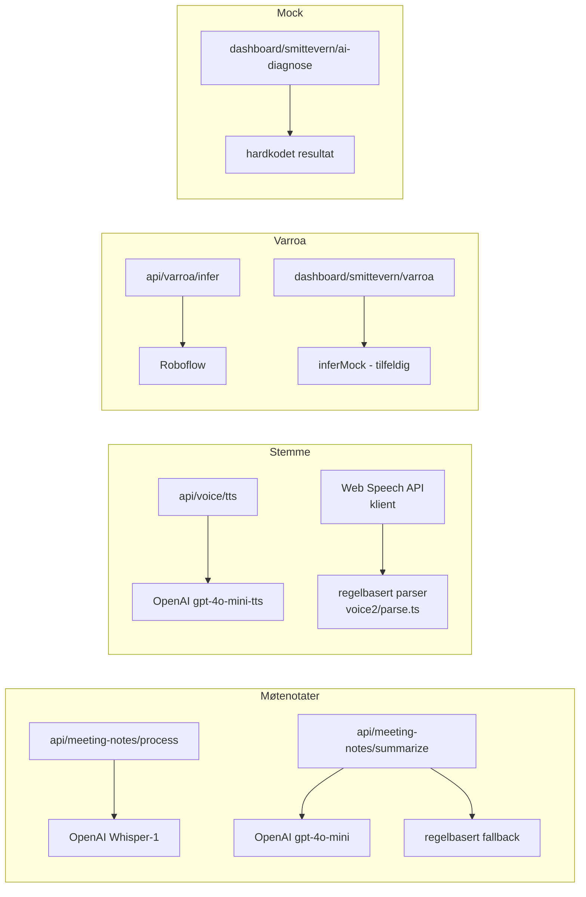

# MASTER_AI_AGENT_MAP

> **Prosjekt:** LEK-Biens Vokter™
> **Dokument:** AI- og agentarkitektur
> **Audit-type:** READ-ONLY
> **Dato:** 2026-11-24
> **Prinsipp:** Bare det som faktisk finnes i kode dokumenteres. Planlagte agenter markeres som IKKE IMPLEMENTERT.

---

## 1. Sammendrag

De opplistede "agentene" (MASTER, ARKITEKT, DEVELOPMENT, DATABASE, AURORA, ML/VARROASCAN, QA MASTER, SECURITY, DEVOPS, BIRØKTER) eksisterer i hovedsak **ikke** som agenter i kodebasen. Faktisk AI-bruk er begrenset til:

1. **OpenAI** i møtenotater (Whisper + GPT) og TTS (stemme).
2. **Roboflow** for varroa-bildeanalyse (tredjepart ML, ikke lokal agent).

AURORA finnes kun som **produktnavn** (verktøyetikett) og som **regelbasert** oppgaveforslag – ikke som autonom LLM-agent.

---

## 2. Agent-for-agent-vurdering

| Agent (opplistet) | Finnes i kode? | Hva finnes i praksis | Status |
|---|---|---|---|
| **MASTER** | Nei | Kun navngivning i tidligere planer/dokumenter | IKKE IMPLEMENTERT |
| **ARKITEKT** | Nei | Ingen kode | IKKE IMPLEMENTERT |
| **DEVELOPMENT** | Nei | Ingen kode | IKKE IMPLEMENTERT |
| **DATABASE** | Nei | Ingen kode | IKKE IMPLEMENTERT |
| **AURORA** | Delvis | Verktøyetikett `🐝 Aurora Birøkterassistent` (`src/lib/toolbox.ts`, id `aurora`) + regelbasert oppgaveforslag i `src/app/apiaries/[id]/page.tsx` (`suggestTasksFromText`, `smartDefaultDueMetaForSuggestion`). Ingen LLM. | DELVIS (ikke agent) |
| **ML / VARROASCAN** | Ja (som ML-kapabilitet) | `src/app/api/varroa/infer/route.ts` (proxy til Roboflow), `src/utils/varroascan.ts`. UI-demo = mock. | DELVIS |
| **QA MASTER** | Nei | Ingen kode (ingen app-tester finnes) | IKKE IMPLEMENTERT |
| **SECURITY** | Nei | Kun `SECURITY_REVIEW.md` (manuell gjennomgang) | IKKE IMPLEMENTERT |
| **DEVOPS** | Nei | Kun `infra/`-stack + CI-løst | IKKE IMPLEMENTERT |
| **BIRØKTER** | Nei (som agent) | "Birøkter"-funksjoner er vanlige appfunksjoner, ikke agent | IKKE IMPLEMENTERT |

---

## 3. Faktisk AI/LLM-bruk (verifisert)

| Kapabilitet | Teknologi | Filer | Status |
|---|---|---|---|
| Transkripsjon | OpenAI Whisper-1 | `src/app/api/meeting-notes/{process,summarize}/route.ts` | IMPLEMENTERT |
| Sammendrag | OpenAI gpt-4o-mini (JSON) + regelbasert fallback | `src/app/api/meeting-notes/summarize/route.ts` | IMPLEMENTERT |
| Talesyntese | OpenAI gpt-4o-mini-tts | `src/app/api/voice/tts/route.ts` | IMPLEMENTERT |
| Talegjenkjenning | Web Speech API (nettleser) | `src/voice2/engine.ts`, `src/hooks/useVoiceRecognition.ts` | IMPLEMENTERT (ikke ML) |
| Intent-parsing | Regelbasert (regex/nøkkelord, ~30 intents) | `src/voice2/parse.ts` | IMPLEMENTERT (ikke LLM) |
| Fuzzy-korreksjon | Levenshtein | `src/utils/voice-diagnostics.ts` | IMPLEMENTERT |
| Varroa-deteksjon | Roboflow | `src/app/api/varroa/infer/route.ts` | DELVIS |
| Helse-AI-diagnose | – | `src/app/dashboard/smittevern/ai-diagnose/page.tsx` | IKKE IMPLEMENTERT (mock) |
| AURORA task-forslag | Regelbasert | `src/app/apiaries/[id]/page.tsx` | IMPLEMENTERT (ikke LLM) |

---

## 4. "Agent-lignende" DB-objekter

Det finnes tabeller med "aurora"-prefiks, men de er **data**, ikke agenter:

- `aurora_suggestions`, `aurora_knowledge`, `aurora_inspection_sequences` (jf. databaseskjema).

Dette indikerer et regel-/kunnskapsbasert AURORA-konsept, ikke et autonomt agent-system.

---

## 5. Konklusjon

- Det finnes **ingen autonom, LLM-drevet agentarkitektur** i kodebasen.
- AI-bruken er **funksjonsnær** (transkripsjon, sammendrag, TTS, bildeanalyse).
- De fleste opplistede agent-navn er **kun planer/dokumentasjon** og skal ikke presenteres som implementert.
- For "MASTER BLUEPRINT"-fasen er dette et viktig utgangspunkt: en eventuell agentarkitektur må bygges, den finnes ikke i dag.
