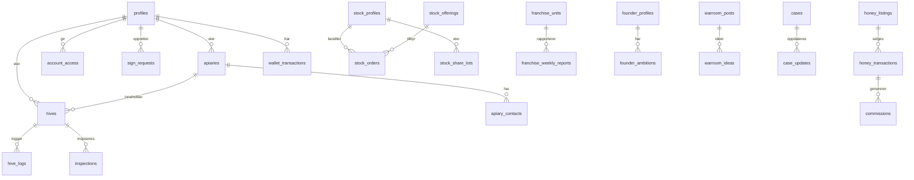

# MASTER_DATABASE_MAP

> **Prosjekt:** LEK-Biens Vokter™
> **Dokument:** Database-audit
> **Audit-type:** READ-ONLY (ingen endringer i DB)
> **Dato:** 2026-11-24
> **Kilde:** `pg_dump --schema-only` (read-only) fra prod-klonen + `psql`-tellinger

> ⚠ **Ingen hemmeligheter eller sensitive data gjengis her.** Kun struktur (navn, typer, relasjoner).

---

## 1. Skjemaer

`public`, `auth`, `storage`, `realtime`, `_realtime`, `graphql`, `graphql_public`, `extensions`, `lek_core`, `net`, `supabase_functions`, `vault`.

---

## 2. Overordnede tall

| Element | Antall |
|---|---|
| Base-tabeller i `public` | 75 |
| Views i `public` | 4 |
| RLS-policyer i `public` | 181 |
| RLS-policyer i `auth` | 0 |
| RLS-policyer i `storage` | 13 |
| Funksjoner i `public` | 29 |
| Triggere i `public` | 13 (+ `on_auth_user_created_stock` + storage-triggere) |
| Enums i `public` | 16 |
| **Tabeller UTEN RLS** | **6** |

---

## 3. Tabeller (public, 75)

```
account_access, account_invites, admin_logs*, apiaries, apiary_certifications, apiary_contacts,
apiary_notes, apiary_tasks, aurora_inspection_sequences, aurora_knowledge, aurora_suggestions,
case_attachments, case_updates, cases, commissions, companies, contacts, demo_sessions,
feedback_reports, feedback_votes, founder_agreement_checks, founder_ambitions, founder_followups,
founder_logs, founder_messages, founder_profiles, founder_timeline, franchise_documents,
franchise_faqs, franchise_messages, franchise_signatures, franchise_training_progress,
franchise_units, franchise_weekly_reports, grunneier_agreements, hive_logs, hives, honey_listings,
honey_transactions, inspections, lek_calendar_events, magic_tokens, mail_messages, meeting_notes,
page_content, pilot_interest, products, profiles, rentals, shareholders, sign_requests,
special_terms_acks, special_terms_events, stock_audit_log, stock_company_info, stock_listings,
stock_offerings, stock_orders, stock_profiles, stock_settings, stock_share_lot_events,
stock_share_lots, survey_pilot_interest, survey_responses, transactions, user_tools,
user_voice_aliases, users, voice2_aliases, voice_aliases, voice_failures, wallet_transactions,
warroom_daily_focus, warroom_ideas, warroom_posts, warroom_user_status
```

> `admin_logs` listet fra kodebruk; verifiser eksakt navn mot skjema ved behov.

### 3.1 Views (public, 4)
`lek_core_apiaries`, `lek_core_beekeepers`, `lek_core_hives`, `view_mlm_monthly_projection`.

### 3.2 ⚠ Tabeller UTEN RLS (6) – risiko
| Tabell | Konsekvens |
|---|---|
| `case_attachments` | War Room-vedlegg potensielt åpne |
| `case_updates` | Saks-oppdateringer potensielt åpne |
| `cases` | War Room-saker potensielt åpne |
| `companies` | Selskapsdata |
| `stock_settings` | Aksjeinnstillinger |
| `users` | ⚠ Brukertabell uten RLS – høyest risiko |

**Merk:** Prosjektregel krever RLS på alle `public`-tabeller. Disse 6 bryter regelen og bør vurderes før produksjon.

---

## 4. Nøkkelrelasjoner (bruker/domene)



> Detaljert PK/FK for alle 75 tabeller er verifisert i skjemadumpen. **Kjente FK-hull** i tidligere fase: manglende FK-constraints i `public` gir PostgREST tomme arrays (se Lessons Learned). Dette bør krysses av ved behov.

---

## 5. Funksjoner (public, 29 – utvalg)

- **Tilgang:** `is_admin`, `is_admin_or_inspector`.
- **MLM/kommisjon:** `process_mlm_sales_commission`, `set_referral_code`.
- **Aksje (stock_*-familien):** funksjoner for registrering, tildeling, kvittering, hard reset.
- **Mattilsynet:** `get_mattilsynet_stats`.
- **Bruker:** `delete_user_by_admin`.
- **Databeskyttelse:** `prevent_apiary_delete`, `prevent_hive_delete`.

---

## 6. Triggere (public, 13 + auth/storage)

- `on_auth_user_created_stock` (auth → stock_profiles).
- Beskyttelses-triggere: `prevent_apiary_delete`, `prevent_hive_delete`.
- `updated_at`-triggere (flere tabeller, jf. `81_apiary_contacts_special_terms_updated_at.sql`).
- Storage-triggere (jf. 13 storage-policyer).
- MLM-kommisjon trigges ved salg (`process_mlm_sales_commission`).

---

## 7. Enums (public, 16)

```
apiary_contact_role, case_status, case_type, case_update_type, grunneier_agreement_status,
honey_status, shareholder_entity_type, stock_listing_status, stock_order_status,
stock_order_type, stock_payment_method, transaction_status, voice_alias_status,
wallet_transaction_type, warroom_post_type, warroom_status_color
```

---

## 8. Migrasjonshistorikk

- **Eldre serie:** `src/db/migrations/02…88` + `switch_to_soft_delete.sql`, pluss `src/db/*.sql` (`mlm_schema`, `honey_exchange_schema`, `honnycoin_schema`, `apply_mlm_complete`) og 10 rot-`supabase_schema_*.sql`.
- **Nyere serie:** `supabase/migrations/20240101…20260627` (~46 filer) – franchise, founder, war room, stock, sign, feedback, voice2, subscription, apiary tasks/calendar.
- **Dobbeltsporet:** Både `src/db/migrations` og `supabase/migrations` finnes. **IKKE VERIFISERT** hvilken serie som faktisk er kjørt mot prod-skjemaet i nyeste tilstand.

---

## 9. RLS – sammendrag

- 181 policyer i `public`, 13 i `storage`, 0 i `auth`.
- Eierskap på `auth`-tabeller må tilhøre `supabase_auth_admin` (prosjektregel).
- **Avvik:** 6 tabeller uten RLS (se 3.2).
- **Ikke verifisert:** om alle policyer er dekkende for alle aksessmønstre.

---

## 10. Forbehold

- Full PK/FK/indeks-detaljering ligger i den genererte skjemadumpen (`--schema-only`, read-only). Denne oversikten oppsummerer strukturen og fremhever avvik.
- Ingen data, nøkler eller persondata er lest ut eller gjengitt.
- Kolonnetyper er ikke listet per kolonne her; ved behov leses skjemadumpen read-only.
