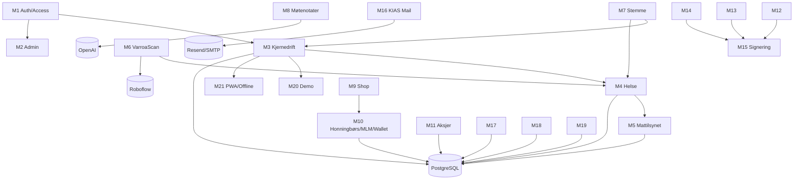

# MASTER_MODULE_REGISTER

> **Prosjekt:** LEK-Biens Vokter™
> **Dokument:** Modulregister (Fase 2 – modulvis gjennomgang)
> **Audit-type:** READ-ONLY
> **Dato:** 2026-11-24

Hver modul dokumenteres med: navn/formål, filplassering, hovedkomponenter, funksjonalitet, DB-avhengigheter, API-avhengigheter, andre modulavhengigheter og implementasjonsstatus.

**Statusnøkkel:** IMPLEMENTERT / DELVIS / IKKE IMPLEMENTERT / IKKE VERIFISERT / FEIL-UFERDIG

---

## M1. Autentisering og tilgangsstyring

- **Formål:** Innlogging, roller, kontodeling, breakglass.
- **Filer:** `src/app/actions/auth.ts`, `src/app/actions/profile.ts`, `src/app/actions/user-management.ts`, `src/app/login/page.tsx`, `src/app/signin/page.tsx`, `src/app/register/page.tsx`, `src/app/auth/callback/route.ts`, `src/app/api/access/**`, `src/app/api/admin/breakglass/reset-password/route.ts`, `src/app/admin/breakglass/page.tsx`, `src/app/settings/access/**`, `src/utils/supabase/{client,server,admin}.ts`, `middleware.ts`, `src/middleware.ts`
- **Hovedkomponenter:** `createServerClient/createClient/createAdminClient`, `protectedPrefixes`-logikk, konto-tilgang (invite/accept/revoke/list/update/leave)
- **Funksjonalitet:** Supabase GoTrue auth via cookies; roller `admin`, `mattilsynet`, `beekeeper` (`profiles.role`); `account_access`-roller `viewer`/`family`/`substitute`; breakglass med timing-safe sammenligning (`crypto.timingSafeEqual`)
- **DB:** `profiles`, `account_access`, `account_invites`, `users` ⚠(uten RLS), `admin_logs`, auth-skjema
- **API:** Supabase Auth Admin API, RPC `is_admin`, `is_admin_or_inspector`, `delete_user_by_admin`
- **Andre avh.:** `@supabase/ssr`
- **Status:** IMPLEMENTERT. Merk: `/admin` dekkes ikke av `protectedPrefixes` (egen sjekk i sider). ⚠ admin-JWT-feil er åpen (`debug-admin-profile-jwt.md`).

---

## M2. Admin (driftspanel)

- **Formål:** Superadmin-verktøy: brukere, e-post, varroascan, feedback, pilot-interesser, temadag, pages/CMS, shop, franchise, founders, grunneier, meeting-notes.
- **Filer:** `src/app/dashboard/admin/**`, `src/app/admin/**`, `src/app/api/admin/**`, `src/app/actions/user-management.ts`
- **Hovedkomponenter:** `AdminNav.tsx`, `dashboard/admin/layout.tsx`, diverse admin-sider
- **Funksjonalitet:** statistikk (`api/admin/stats`), nuke (slett survey/pilot-data), PDF-rapport, pilot-interesse-eksport, temadag-cleanup, CMS-sider, mail-admin
- **DB:** `profiles`, `survey_responses`, `pilot_interest`, `feedback_reports`, `page_content`, `mail_messages`, `admin_logs`
- **API:** `src/app/api/admin/**`, `src/services/mail/**`
- **Status:** IMPLEMENTERT. ⚠ `api/admin/nuke/route.ts` returnerer stack trace i feil (se kvalitetsrapport).

---

## M3. Kjernedrift: bigårder, kuber, inspeksjoner

- **Formål:** Birøkterens daglige drift.
- **Filer:** `src/app/apiaries/**`, `src/app/hives/**`, `src/components/InspectionModal.tsx`, `src/app/hives/[id]/new-inspection/page.tsx`, `src/app/api/lek-core/**`, `src/app/api/inspections/repair-owner/route.ts`, `src/app/archive/page.tsx`, `src/app/dashboard/beekeeper/checklist/page.tsx`
- **Funksjonalitet:** Bigård/kube-CRUD; **to parallelle inspeksjonsflyter:** (a) `InspectionModal` → `hive_logs`, (b) `hives/[id]/new-inspection` → `inspections` + `hive_logs`. Oppgavelister, kalender, soft-delete.
- **DB:** `apiaries`, `hives`, `hive_logs`, `inspections`, `apiary_notes`, `apiary_tasks`, `apiary_certifications`, `apiary_contacts`, `lek_calendar_events`, `lek_core_*` (views/speiling)
- **API:** `api/lek-core/*` (enveis speiling til `lek_core` via `auth_user_id`)
- **Andre avh.:** `utils/offline-storage.ts`, `OfflineContext`, `utils/geo.ts`
- **Status:** IMPLEMENTERT, men **DELVIS duplisert** inspeksjonsmodell (`hive_logs` vs `inspections`) og `lek_core` er enveis-skriving.

---

## M4. Helse / smittevern / sykdom

- **Formål:** Sykdomsregistrering, veileder, (mock) AI-diagnose.
- **Filer:** `src/app/dashboard/smittevern/**` (`page.tsx`, `ai-diagnose/`, `sykdommer/[slug]/`, `varroa/`, `veileder/`), `src/app/actions/sickness.ts`, `src/components/SicknessRegistrationModal.tsx`
- **Funksjonalitet:** Registrering av sykdom på kube (varroa-tall, dødelighet, atferd, bilder), "nabovarsel" (varsler alle brukere, ikke geo-filtrert), statisk sykdomsveileder (6 seksjoner), HEIC-konvertering.
- **DB:** `hive_logs` (`action='SYKDOM'`, `shared_with_mattilsynet`), `admin_logs`, `profiles`, Storage `sickness-images`
- **Andre avh.:** `useVoiceRecognition`, `heic2any`
- **Status:** Registrering/veileder IMPLEMENTERT. `ai-diagnose` = **IKKE IMPLEMENTERT (mock)** – hardkodet resultat + `setTimeout`, ingen API/ML. Varroa-teller i UI = mock.

---

## M5. Mattilsynet / regelverk

- **Formål:** Myndighetsportal: smittekart, register, varsler, beredskapsrom.
- **Filer:** `src/app/mattilsynet/page.tsx`, `src/app/dashboard/mattilsynet/**` (dashboard, alerts, alert/[id], map, registry, reports, layout, components/AlertsPoller.tsx), `src/app/api/mattilsynet/**`, `src/app/actions/mattilsynet.ts`, `src/components/IncidentMap.tsx`, `MattilsynetMap.tsx`
- **Funksjonalitet:** Rollebasert tilgang (`mattilsynet`/`admin`); varsler-poller (10 s, Web Audio-alarm); beredskapsrom med smittesone (Haversine); e-postvarsel til berørte; register (birøktere/bigårder/kuber m/ sekvensnummer); rapporter/PDF; backfill av `lek_core_*`.
- **DB:** `hive_logs`, `profiles`, `lek_core_*`, `admin_logs`, auth-brukere
- **API:** `api/mattilsynet/*`, RPC `get_mattilsynet_stats`, `getMailService()`
- **Status:** IMPLEMENTERT, men med **mock geokoding** (GEO_CACHE + fallback rundt Halden) og **mock koordinater** for bigårder uten GPS.

---

## M6. VarroaScan (ML/bildeanalyse)

- **Formål:** Deteksjon av varroamidd i bilder via Roboflow.
- **Filer:** `src/app/api/varroa/infer/route.ts`, `src/utils/varroascan.ts`, `src/app/dashboard/smittevern/varroa/page.tsx`, `src/app/dashboard/admin/varroascan/page.tsx`, `src/app/scan/page.tsx`
- **Funksjonalitet:** Proxy til `https://detect.roboflow.com/{model}/{version}`; skjuler API-nøkkel; 400 med "Bruk Mock-modus" hvis nøkkel mangler; UI-demo bruker `inferMock()` (tilfeldig).
- **DB:** Ingen direkte.
- **API:** Roboflow (`ROBOFLOW_API_KEY` + aliaser), eksternt VarroaScan-system (`NEXT_PUBLIC_VARROASCAN_URL`).
- **Status:** Proxy DELVIS (avhengig av nøkkel); demo = mock; ekte Roboflow brukes ikke i UI.

---

## M7. Stemme (V1 og V2)

- **Formål:** Talestyrt inspeksjon.
- **Filer:** `src/voice2/{engine,parse,alias-store,types}.ts`, `src/utils/{voice-parser,voice-alias,voice-diagnostics}.ts`, `src/hooks/useVoiceRecognition.ts`, `src/components/{VoiceAssistant,WordTraining}.tsx`, `src/app/api/voice/**`, `src/app/api/voice2/aliases/route.ts`, `src/app/api/admin/voice/**`, `src/app/tools/{voice,word-training}/page.tsx`, `src/app/dashboard/admin/voice/page.tsx`
- **Funksjonalitet:** Web Speech API (`nb-NO`) for gjenkjenning; **regelbasert** parser (~30 intents); alias-system (globale+personlige) m/ lokalt cache; Levenshtein fuzzy-korreksjon; feillogg; ordtrening (80+ setninger). TTS via OpenAI `gpt-4o-mini-tts` (fallback nettleser).
- **DB:** `voice_aliases`, `voice2_aliases`, `user_voice_aliases`, `voice_failures`
- **API:** Web Speech API (klient), OpenAI TTS (`OPENAI_API_KEY`)
- **Status:** IMPLEMENTERT. V1 ser erstattet av V2 (begge finnes). Ingen LLM i parsing.

---

## M8. Møtenotater / referater (AI)

- **Formål:** Transkripsjon + AI-sammendrag av møter.
- **Filer:** `src/app/api/meeting-notes/{process,summarize,audio-url}/route.ts`, `src/app/referater/**`, `src/app/dashboard/admin/meeting-notes/page.tsx`
- **Funksjonalitet:** Opplasting av lyd til `meeting-audio`; Whisper-1 transkribering; `gpt-4o-mini` JSON-sammendrag; regelbasert `generateFallback`; runtime nodejs, maxDuration 300.
- **DB:** `meeting_notes`, Storage `meeting-audio`
- **API:** OpenAI (`OPENAI_API_KEY`)
- **Status:** IMPLEMENTERT (faktisk LLM-bruk).

---

## M9. Butikk (shop)

- **Formål:** Salg av produkter.
- **Filer:** `src/app/shop/**`, `src/app/actions/shop.ts`, `src/context/CartContext.tsx`, `src/components/shop/{ProductForm,CartSidebar}.tsx`, `src/types/shop.ts`, `src/utils/shop-constants.ts`, `src/app/api/create-order/route.ts`, `src/components/shop`, `src/db/migrations/{25,40–44…}_*.sql`, `src/app/dashboard/admin/shop/**`
- **Funksjonalitet:** Produktliste, kurv (localStorage/CartContext), checkout-side, success-side. Admin-CRUD for produkter.
- **DB:** `products`
- **API:** `api/create-order` (CORS-beskyttet)
- **Status:** **DELVIS** – checkout er i praksis mock; ordrer persisteres ikke fullt ut i normal flyt (jf. `company_orders` kun via egen migrasjon).

---

## M10. Honningbørs + MLM + HonnyCoin/Wallet

- **Formål:** Markedsplass for honning, kommisjonssystem, intern valuta.
- **Filer:** `src/app/honey-exchange/**`, `src/types/honey-exchange.ts`, `src/app/wallet/page.tsx`, `src/db/{honey_exchange_schema,mlm_schema,honnycoin_schema,apply_mlm_complete}.sql`, `src/lib/subscriptions.ts`
- **Funksjonalitet:** Opprett/selg/resell-parti; transaksjoner; kommisjon via SQL-trigger `process_mlm_sales_commission`; wallet-transaksjoner.
- **DB:** `honey_listings`, `honey_transactions`, `commissions`, `wallet_transactions`, `transactions`, `view_mlm_monthly_projection`
- **Status:** **DELVIS** – kommisjon beregnes kun av DB-trigger; ingen app-kode skriver til `commissions` direkte.

---

## M11. Aksjeplattform (stock)

- **Formål:** Aksjehandel for "AI Innovate AS".
- **Filer:** `src/app/aksjer/**` (inkl. `actions.ts`, `admin/**`), `src/app/api/aksjer/**`, `supabase/migrations/{20260405_stock_platform, 20260407_stock_shareholder_no, 20260415_fix_stock_handle_new_user_rls}.sql`, `src/app/aksjer/admin/DangerInitResetForm.tsx`
- **Funksjonalitet:** Kjøp/salg, ordrer, aksjonærregister, kvittering/PDF, manuell betalingsbekreftelse, hard-reset (danger), RPC-familie.
- **DB:** `stock_*` (settings, listings, offerings, orders, profiles, share_lots, share_lot_events, company_info, audit_log, shareholders), views/functions `stock_*`
- **Status:** IMPLEMENTERT. ⚠ `STOCK_ADMIN_DANGER_PASSWORD`-sammenligning er **ikke timing-safe** (`actions.ts` l.402).

---

## M12. Franchise

- **Formål:** Franchiseporta.
- **Filer:** `src/app/dashboard/franchise/**`, `src/app/franchise/page.tsx`, `src/app/actions/franchise.ts`, `src/app/api/franchise/report/[id]/pdf/route.tsx`, `src/utils/franchise-report-pdf-template.ts`, `src/app/dashboard/admin/franchise/**`
- **Funksjonalitet:** Branding, kontakt, FAQ, manual, oppskrifter, rapporter (uke), trening, avtaler (license/shareholder).
- **DB:** `franchise_*` (units, documents, faqs, messages, signatures, training_progress, weekly_reports)
- **Status:** IMPLEMENTERT.

---

## M13. Medgründer (founder)

- **Formål:** Medgründerprogram.
- **Filer:** `src/app/dashboard/founder/**`, `src/app/actions/{founder,founder-community}.ts`, `src/app/api/founder/agreement/pdf/route.tsx`, `src/utils/founder-agreement-pdf-template.ts`, `src/app/dashboard/admin/founders/page.tsx`
- **DB:** `founder_*` (profiles, ambitions, followups, logs, messages, timeline, agreement_checks)
- **Status:** IMPLEMENTERT.

---

## M14. Grunneier-portal

- **Formål:** Selvbetjening for grunneiere (leieavtaler).
- **Filer:** `src/app/grunneier/page.tsx`, `src/app/api/grunneier/**`, `src/app/dashboard/admin/grunneier/page.tsx`, `supabase/migrations/{20260...grunneier}.sql` (`78_grunneierportal`, `79_grunneierportal_agreements`, `88_grunneier_agreements_terminated`)
- **Funksjonalitet:** Invite, magic-login-lignende flyt, avtaler, session.
- **DB:** `grunneier_agreements`, `apiary_contacts`, `contacts`
- **Status:** IMPLEMENTERT.

---

## M15. Signering (e-sign)

- **Formål:** Elektronisk signering med kvittering.
- **Filer:** `src/app/signering/**`, `src/app/sign/**`, `src/app/api/signing/**`, `src/lib/{signing,signing-receipt}.ts`, `src/hooks/useSigningAttention.ts`, `docs/signering-epost-oppsett.md`, `supabase/migrations/2026062*_sign_requests*.sql`
- **Funksjonalitet:** Opprett signeringsforespørsel, token-basert signering, e-post (Resend/SMTP), PDF-kvittering (Puppeteer), statusbackfill.
- **DB:** `sign_requests`, `franchise_signatures`
- **Status:** IMPLEMENTERT. ⚠ `signing.ts` bruker `x-forwarded-host` til URL-bygging (se sikkerhet).

---

## M16. KIAS Mail (mail-modul)

- **Formål:** Intern e-postklient. **LOCKED** (`LOCKED_FEATURES.md`).
- **Filer:** `src/services/mail/**`, `src/app/actions/mail.ts`, `src/app/dashboard/mail/page.tsx`, `src/components/mail/MessageDetail.tsx`, `src/app/api/test-email/route.ts`, `src/sql/00_kias_mail.sql`
- **Funksjonalitet:** Strategi-mønster: Resend → Mock → Nodemailer/SMTP → Mock fallback. Mock lagrer i `mail_messages` og brukes også som lokal kopi.
- **DB:** `mail_messages`, Storage `mail-attachments`
- **Status:** IMPLEMENTERT. `DomeneshopMailService` er **død kode** (ikke koblet i `index.ts`).

---

## M17. War Room / community

- **Formål:** Diskusjons-/community-rom.
- **Filer:** `src/app/actions/{war-room,war-room-cases,war-room-resolve}.ts`, `src/components/{WarRoomDashboard,WarRoomChat}.tsx`, `supabase/migrations/20260205_war_room_*.sql`, `20260218_war_room_cases.sql`
- **DB:** `warroom_posts`, `warroom_ideas`, `warroom_daily_focus`, `warroom_user_status`, `cases`, `case_updates`, `case_attachments` ⚠(uten RLS)
- **Status:** IMPLEMENTERT. ⚠ `cases`, `case_updates`, `case_attachments` mangler RLS.

---

## M18. Feedback

- **Filer:** `src/app/feedback/page.tsx`, `src/app/api/feedback/{vote,priority-vote}/route.ts`, `src/app/dashboard/admin/feedback/page.tsx`, `supabase/migrations/20260621_feedback_reports.sql`, `20260623_*`
- **DB:** `feedback_reports`, `feedback_votes`
- **Status:** IMPLEMENTERT.

---

## M19. Survey / pilot-rekruttering

- **Filer:** `src/app/survey/**`, `src/app/actions`, `src/app/api/survey/submit/route.ts`, `src/app/api/admin/pilot-interest/**`, `src/app/api/admin/survey-responses/**`, `src/components/survey/**`, `src/lib/survey/**`, `supabase/migrations/20240120_add_survey_columns.sql`, `20240123_rebuild_survey_schema.sql`
- **DB:** `survey_responses`, `survey_pilot_interest`, `pilot_interest`
- **Status:** IMPLEMENTERT.

---

## M20. Demo-modus

- **Formål:** Trygg demo på staging.
- **Filer:** `src/app/api/demo/{session/,write/}/**`, `src/components/DemoModeBanner.tsx`, `src/middleware.ts`, `middleware.ts`, `src/db/migrations/{86_demo_sessions,87_demo_writing}.sql`
- **Funksjonalitet:** Gating via host (`staging.`) eller `LEK_DEMO_ENABLED`; session-start; cookies; `demo_session_id`; write-endepunkter for demo-data.
- **DB:** `demo_sessions`
- **Status:** IMPLEMENTERT.

---

## M21. PWA / offline

- **Filer:** `next.config.js`, `public/{sw.js,manifest.json,offline.html,workbox-*.js,fallback-*.js}`, `src/context/{PWAContext,OfflineContext}.tsx`, `src/utils/offline-storage.ts`, `src/components/InstallPrompt.tsx`, `src/app/offline/page.tsx`
- **Funksjonalitet:** Service worker (next-pwa), 12 runtime-cache-regler, IndexedDB (`BeekeeperOfflineDB` v2) for offline-inspeksjoner, synk ved online, install-prompt (iOS/Android/desktop).
- **Status:** IMPLEMENTERT.

---

## M22. CMS (page_content)

- **Filer:** `src/app/dashboard/admin/pages/**`, `supabase/migrations/30_create_page_content_cms.sql`, `src/db/migrations/30_create_page_content_cms.sql`
- **DB:** `page_content`
- **Status:** IMPLEMENTERT.

---

## M23. Verktøy (tools)

- **Filer:** `src/app/tools/{voice,word-training,labels,driftsmateriell,bikubekort}/page.tsx`, `src/lib/toolbox.ts`, `src/utils/hive-labels-pdf.ts`, `supabase/migrations/20260615_user_tools.sql`
- **Funksjonalitet:** `TOOLBOX_TOOLS`-register (active/extra/premium, låste premium-verktøy), etiketter/QR-PDF, driftsmateriell, bikubekort.
- **DB:** `user_tools`
- **Status:** IMPLEMENTERT (premium-verktøy er låst/ikke bygget).

---

## M24. Diverse sider

- `src/app/kids-beekeeper/page.tsx` – barnevennlig side.
- `src/app/lei-en-kube/page.tsx` – leieavtale (jsPDF klient-side). Nevner Stripe som tekst, men **ingen Stripe-integrasjon** (IKKE VERIFISERT/IKKE IMPLEMENTERT).
- `src/app/network/page.tsx`, `src/app/missions/**`, `src/app/info/**`, `src/app/about/page.tsx`, `src/app/archive/page.tsx`.
- **Status:** IMPLEMENTERT (presentasjons-/infosider).

---

## M25. Infrastruktur

- **Filer:** `infra/source/**`
- **Status:** IMPLEMENTERT (offisiell Supabase self-hosted-stack). Se MASTER_INTEGRATION_MAP.md.

---

## Modulavhengighetskart (overordnet)

