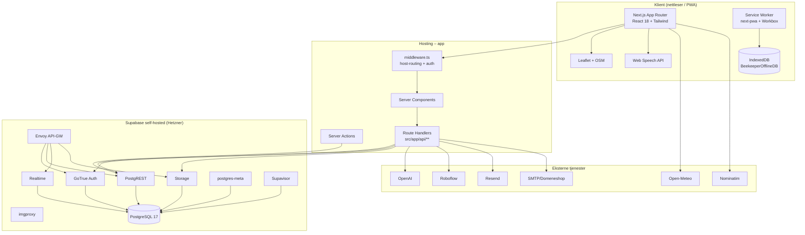
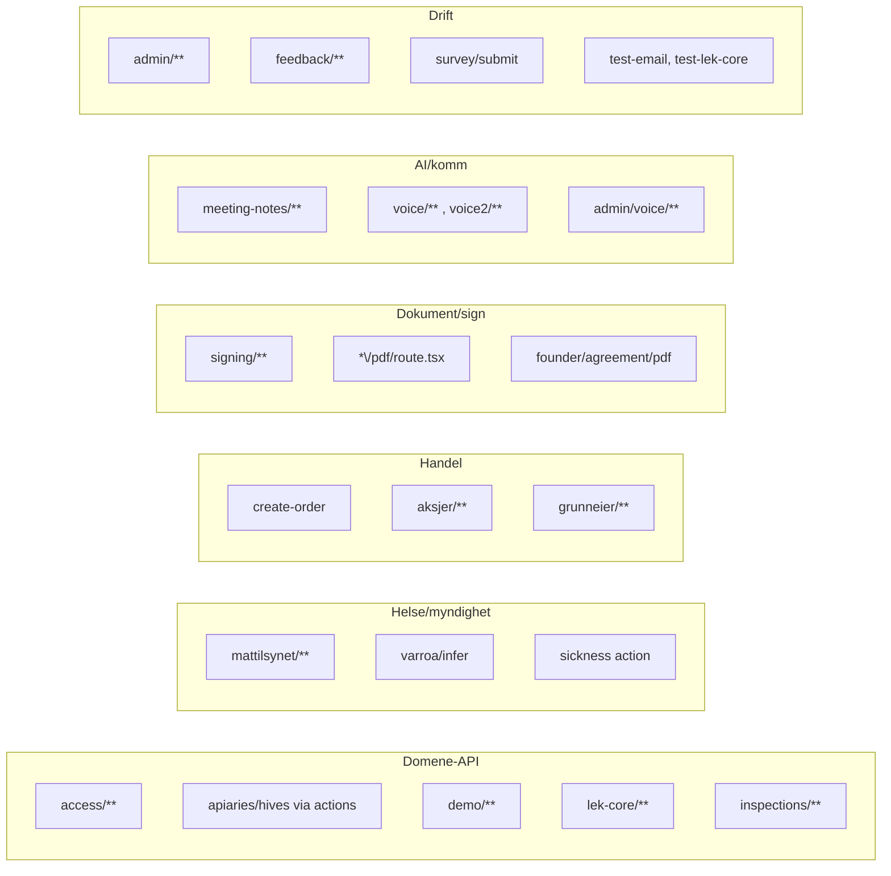
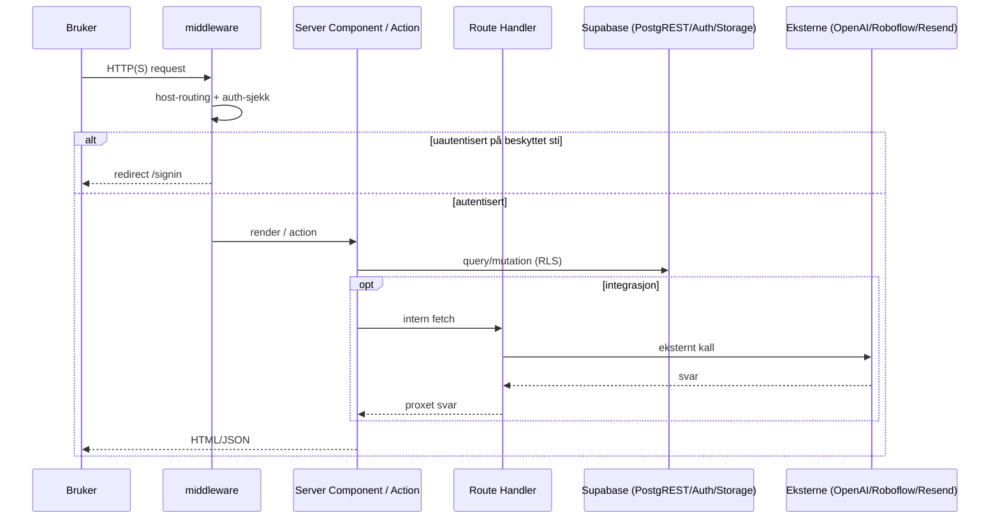

# MASTER_SYSTEM_ARCHITECTURE

> **Prosjekt:** LEK-Biens Vokter™
> **Dokument:** Systemarkitektur (Fase 3 + Fase 5)
> **Audit-type:** READ-ONLY
> **Dato:** 2026-11-24

---

## 1. Overordnet systemkart

---

## 2. Frontend

- **Ramme:** Next.js 14.2.3 App Router, React 18, TypeScript (`strict: true`), Tailwind.
- **Stil:** `src/app/globals.css`, `tailwind.config.ts`.
- **Layout/komponenter:** `src/components/**` (26), `src/context/**` (PWA/Offline/Cart).
- **Multi-host UI:** `middleware.ts` ruter `admin.`/`mattilsynet.`/`aksjer.`/`staging.` til ulike rutesett; `staging.` aktiverer demo.
- **Klient-integrasjoner:** Leaflet (kart), Web Speech API (stemme), jsPDF (PDF), html5-qrcode (skanning), heic2any (bildekonvertering), IndexedDB (offline).
- **PWA:** `next-pwa`, manifest, service worker, offline-fallback.

---

## 3. Backend

- **Route Handlers:** `src/app/api/**` (~70 ruter) for REST-aktige operasjoner, integrasjonsproxyer og webhooks.
- **Server Actions:** `src/app/actions/**` (13 filer) for mutasjoner (auth, shop, mail, mattilsynet, founder, franchise, war-room, sickness, profile, user-management).
- **Supabase-klienter:** `src/utils/supabase/{client,server,admin}.ts` (`createClient`, `createServerClient`, `createAdminClient`). Admin-klient bruker `SUPABASE_SERVICE_ROLE_KEY` (RLS-bypass) og brukes på ~94 steder.
- **PDF:** Server-side via Puppeteer + `@sparticuz/chromium` (`next.config.js` `serverComponentsExternalPackages`).
- **Runtime:** Node runtime for AI-/PDF-ruter; `maxDuration 300` på tunge ruter.

---

## 4. Database (kort – se MASTER_DATABASE_MAP.md)

- PostgreSQL 17 på Supabase self-hosted.
- Skjemaer: `public`, `auth`, `storage`, `realtime`, `_realtime`, `graphql`, `graphql_public`, `extensions`, `lek_core`, `net`, `supabase_functions`, `vault`.
- RLS aktivert på de fleste `public`-tabeller (181 policyer). **6 tabeller uten RLS** (se databasekartet).
- Aksess via PostgREST; RPC for komplekse operasjoner.

---

## 5. Autentisering

- Supabase GoTrue; cookies via `@supabase/ssr`.
- Roller i `profiles.role`: `admin`, `mattilsynet`, `beekeeper`.
- Konto-deling: `account_access` (viewer/family/substitute).
- Middleware beskytter prefikser og redirecter uautentiserte.
- Breakglass: timing-safe passord-reset (`ADMIN_BREAKGLASS_SECRET`).
- ⚠ **Åpen feil:** GoTrue signerer ES256, PostgREST kun HS256 → "No suitable key or wrong key type" ved admin-profilhenting (`debug-admin-profile-jwt.md`). Fiks: gi PostgREST `JWT_JWKS`.

---

## 6. API-struktur (kategorier)

---

## 7. AI-integrasjoner

| Tjeneste | Modell/endepunkt | Filer | Formål | Status |
|---|---|---|---|---|
| OpenAI Whisper | `whisper-1` | `api/meeting-notes/{process,summarize}` | Lydtranskripsjon | IMPLEMENTERT |
| OpenAI Chat | `gpt-4o-mini` | `api/meeting-notes/summarize` | JSON-sammendrag (+regelbasert fallback) | IMPLEMENTERT |
| OpenAI TTS | `gpt-4o-mini-tts` (voice alloy, wav, ≤180 tegn) | `api/voice/tts/route.ts` | Talesyntese | IMPLEMENTERT |
| Roboflow | `detect.roboflow.com/{model}/{version}` | `api/varroa/infer/route.ts` | Varroa-deteksjon | DELVIS (krever nøkkel; UI=demo) |
| "AI-diagnose" (helse) | – | `dashboard/smittevern/ai-diagnose/page.tsx` | Påstått bilde-diagnose | IKKE IMPLEMENTERT (hardkodet mock) |
| AURORA task-forslag | regelbasert | `src/app/apiaries/[id]/page.tsx` (`suggestTasksFromText`) | Oppgaveforslag fra notat | IMPLEMENTERT (ikke LLM) |

Se MASTER_AI_AGENT_MAP.md for full agent-vurdering.

---

## 8. ML-funksjonalitet

- **Eneste reelle ML:** Roboflow objektgjenkjenning for varroa (tredjepart, ikke hostet lokalt).
- **Ingen lokale modeller/trening.** `public/varroa-samples/` er kun eksempelbilder.
- Stemme er ikke ML – Web Speech API (nettleser) + regelbasert parser.

---

## 9. Fil- og bildelagring

- **Supabase Storage** (buckets referert i kode/migrasjoner): `sickness-images`, `inspection-images`, `hive-images`, `meeting-audio`, `mail-attachments`, med flere.
- **imgproxy** for bildeprosessering.
- **Klient-side offline:** IndexedDB `BeekeeperOfflineDB` (inspeksjoner + bilde-Blobs).

---

## 10. PWA-funksjonalitet

- `next-pwa` (dest `public`), `manifest.json`, offline-fallback `/offline.html`.
- 12 runtime-cache-regler (fonts, bilder, js, css, data, cross-origin, pages).
- Egen registrering i `OfflineContext`; install-prompt i `InstallPrompt`; synk av offline-inspeksjoner.

---

## 11. Eksterne tjenester

OpenAI, Roboflow, Resend, Nodemailer/SMTP (Domeneshop), Open-Meteo, Nominatim, Supabase self-hosted. Se MASTER_INTEGRATION_MAP.md.

---

## 12. Hosting og infrastruktur

- **App:** Vercel (preview/production-miljøer via env).
- **Backend/DB:** Hetzner Cloud (Helsinki) – én server, Supabase self-hosted via Docker Compose (`infra/source/`).
- **Nettverk:** Kun port 22/80/443 eksternt åpne; DB-porter (5433/6544/8100) stengt eksternt.
- **Backup:** Hetzner Storage Box BX11 (offsite).
- **Proxy:** Caddy/Envoy i stacken.
- **Driftsstatus:** staging kjører self-hosted; produksjonsappen peker fortsatt mot gammelt Supabase Cloud inntil DNS-omkobling.

---

## 13. Kommunikasjon mellom komponenter

---

## 14. Arkitektoniske observasjoner

- Klar lagdeling: middleware → sider/actions → Supabase.
- Service-role brukes bredt (admin-operasjoner) – forventet, men øker risikoen ved feil i tilgangssjekker.
- Dupliserte inspeksjonsdata (`hive_logs` + `inspections`) er en arkitektonisk gjeld.
- `lek_core`-speiling er enveis (app → core), ingen synk tilbake.
- Flere "AI"-flater er mock (helse-diagnose, varroa-UI), noe som kan gi feil inntrykk av funksjonalitet.
